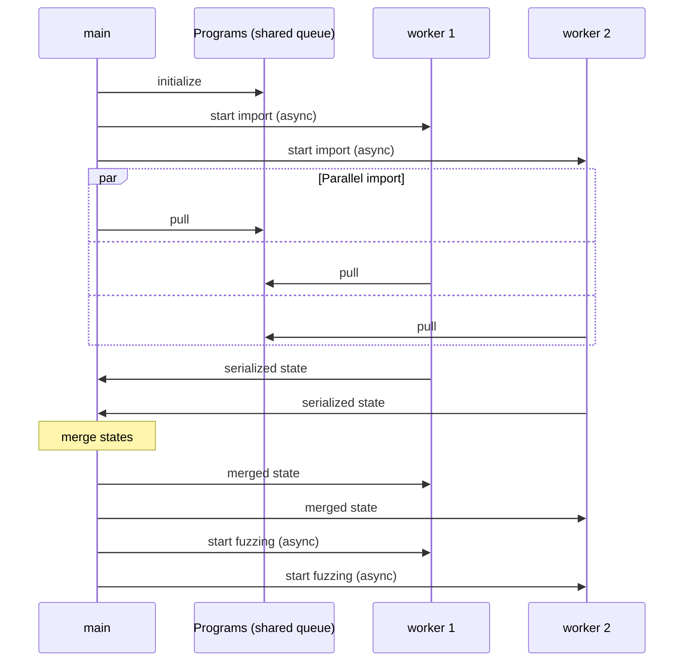
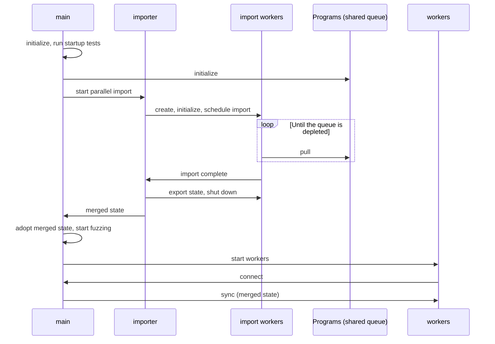
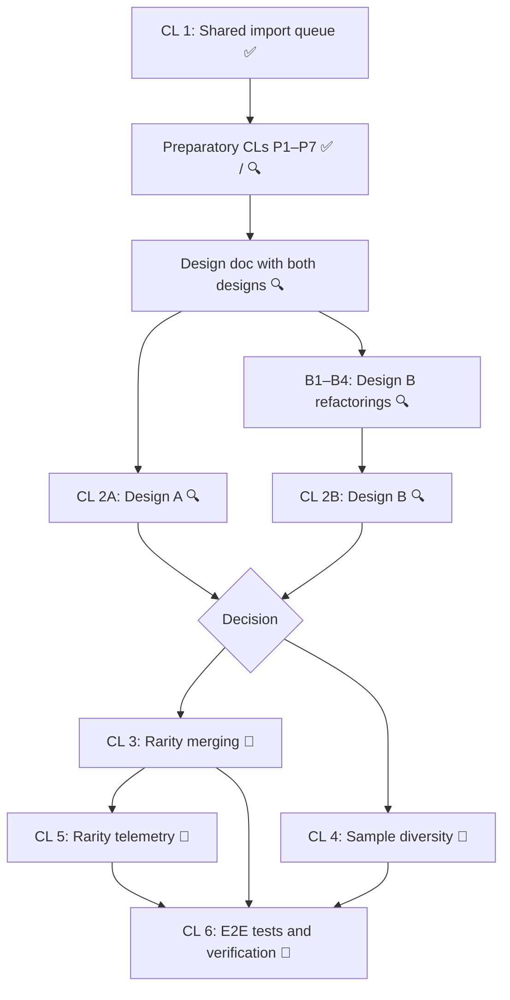

# Parallelized Corpus Import on Multi-Threaded Workers

## TL;DR

This feature parallelizes Fuzzilli's corpus import phase across multiple threads within one Fuzzilli process (`--jobs=N`). Instead of importing sequentially on the main instance while worker threads wait or fuzz on an empty corpus, several threads concurrently consume programs from a shared, in-memory, thread-safe import queue. Once the queue is depleted, their corpora and coverage are merged into the main instance, and all instances continue fuzzing from the merged state.

Two designs are evaluated as equal alternatives (see [Design Alternatives](#design-alternatives)):
- **Design A: Coordinated import on the fuzzer instances.** The main instance and its regular `ThreadSync` workers import in new fuzzer states and synchronize through a barrier in the distributed fuzzing protocol, which merges their states and broadcasts the result back.
- **Design B: Short-lived import workers (Fuzzer-based runners).** A separate helper spawns temporary, symmetric fuzzer instances without any modules, which import and whose states are merged into the idle main instance. Only then do the regular workers start, and they receive the merged state through the existing synchronization.

It's not yet decided which design will be used. Both implementations may be developed side by side on top of the shared preparatory changes to compare them (see the [CL Roadmap](#step-by-step-implementation-plan-cl-roadmap)).

*(Note: Network-distributed fuzzing via `NetworkSync` is explicitly out of scope; multi-machine cluster setups will continue to use standard sequential/delayed worker synchronization).*

---

## Production Safety & Guardrails (Meta-Goal)

A foundational architectural requirement for this feature is that **no changes should impact existing production configurations or execution paths by default**.

- **Preserve Default Behavior:** By default, Fuzzilli must continue to perform single-threaded sequential imports with delayed worker startup exactly as it does today.
- **Strict Scope (In-Process Only):** Parallel import is strictly scoped to instances within one Fuzzilli process sharing process memory: the regular `ThreadSync` workers in Design A, and temporary in-process import workers in Design B. Network-distributed fuzzing (`NetworkSync`) is explicitly out of scope and remains untouched.
- **Strict Feature-Flagging:** All parallelized import routines, their coordination logic (the barrier protocol in Design A, the import helper in Design B), trace buffering, and coverage drop-out mechanisms must be strictly gated behind configuration flags (e.g., `--parallelImport`, `--randomEdgeReset`).
- **No-Impact Refactoring:** Any modifications to shared base classes, core engines, or serialization layers must be clean refactorings that introduce zero behavioral changes or performance degradation for non-parallel modes.
- **Off-Production Testing:** The new parallel mode and its settings will be thoroughly tested and validated on separate, isolated machines prior to any production rollouts.

---

## Non-Goals

- **Network Mode (`NetworkSync`):** Implementing parallel corpus import for network-distributed instances (`--networkMaster` / `--networkWorker`) is explicitly a **non-goal**. Network setups introduce socket transport latency, lack shared memory, and require distributed scheduling primitives. Multi-machine cluster setups will continue to operate under the existing sequential/delayed worker synchronization model.
- **Modifying Default Single-Threaded Behavior:** The default single-threaded sequential import must remain functionally and performance-wise identical.
- **Global In-Memory Trace Buffering:** We explicitly avoid uncapped trace buffering across all programs (Option 1) to prevent high peak memory usage during large corpus imports.

---

## Background: Existing Corpus Import

In Fuzzilli's current architecture, corpus import is a single-threaded operation executing solely on the main fuzzer instance. Because each program being imported must be executed and potentially minimized, importing large corpora (thousands of files) can take a significant amount of time (from minutes to hours).

While the main thread is importing:
1. **Underutilization:** Worker threads/processes either wait or start fuzzing with a delayed offset (configured via `--workerDelay`, ranging from 1 to 10 minutes by default).
2. **Redundancy:** If workers are started early, they start with a serialized snapshot of whatever the main thread has imported so far. Once running, any new coverage found by workers is sent to the parent, which in turn distributes it to other workers. This requires each thread to execute full coverage-convergence runs for every shared sample, adding significant overhead.

---

## Proposed Feature: Parallel Import

We propose a fully parallelized import mode, in which several threads concurrently import programs from a shared import queue. When the queue is empty, their states are merged and all instances continue fuzzing from the merged state.

## Design Alternatives

Both designs share the following building blocks, most of which have already landed (see the [CL Roadmap](#step-by-step-implementation-plan-cl-roadmap)):
- The shared `ThreadSafeImportQueue`, which also aggregates the import statistics of all instances consuming from it (see [1. Thread-Safe Import Queue](#1-thread-safe-import-queue)).
- `ProgramCoverageEvaluator.mergeCoverageStates()`, which computes the union of exported coverage bitmaps.
- Merging the corpora: a concatenation deduplicated by program ID for `BasicCorpus`, and the [Rarity Merge Algorithm](#the-rarity-merge-algorithm-selected-option-2) for `RarityCorpus` (CL 3).
- Persistence: the parent dispatches `InterestingProgramFound` for all merged programs, so `Storage` writes them to disk before `old_corpus` is deleted on `--resume` (see item 7 in [section 4](#4-design-a-resolved-concurrency-edge-cases-and-error-scenarios)).
- The `--parallelImport` flag (off by default) and the same checks for unsupported configurations: only `--corpus=basic` until CL 3, and no network instance types.

They differ in *who* imports and *how* the results are synchronized.

### Design A: Coordinated Import on the Fuzzer Instances

All fuzzer instances (parent and workers) start up immediately without delay and concurrently import programs from a shared import queue. When the queue is empty, the threads synchronize through a barrier in the distributed fuzzing protocol (`ThreadSync`), merge their state, and transition to fuzzing together.

#### Sequence Diagram



#### Process Lifecycle and Coordination

1. **Initialization:**
   - The main thread populates a thread-safe, synchronized queue (`ThreadSafeImportQueue`) with the shuffled corpus.
   - Worker threads/instances are launched immediately without delay.

2. **Parallel Import Phase:**
   - Both the main thread and all worker threads transition to a new `.parallelImport` state.
   - All threads concurrently pull from the shared queue and run `importProgramWithFixup()`.

3. **Coordination Barrier (Depletion):**
   - When the shared queue is fully depleted, each thread finishes its current program and serializes its local corpus and coverage evaluator state.
   - Worker threads transmit their serialized states back to the main thread via the existing distributed fuzzing channel (`ThreadSync`).

4. **Merging & Sync Phase:**
   - The main thread collects all serialized states from the worker threads.
   - Once all states are collected, the main thread performs a fast union merge of all corpora and coverage evaluation states (creating a union of discovered edges and seeds).
   - The main thread distributes the merged unified state to all worker threads.

5. **Transition to Fuzzing:**
   - All worker threads apply the received unified state, updating their local corpus and coverage evaluators.
   - All instances simultaneously transition to the `.fuzzing` state.

### Design B: Short-Lived Import Workers (Fuzzer-Based Runners)

The parallel import is moved out of the regular fuzzer instances. After the main instance has been set up and has run its startup tests, a separate helper (`ParallelCorpusImporter`) spawns N temporary, symmetric *import workers*. Each import worker is a regular `Fuzzer` instance without any modules (no `ThreadChild`, `Statistics` or `Storage`). It acts as a "runner" that bundles an executor (the REPRL script runner), a program evaluator (coverage shared memory) and a corpus, together with everything else importing a program requires. The import workers import in the existing `.corpusImport` state from the shared queue. Once all of them are done, the helper merges their states into the main instance and shuts them down. Only then does the main instance start fuzzing and the regular workers start up; they receive the merged state through the existing `.sync` message.

**Why Fuzzer-based runners instead of a new runner abstraction:** Importing a program needs most of what a `Fuzzer` is: execution (lifter, script runner, `PreExecute`/`PostExecute` events), determinism checks that re-execute the program, minimization (which builds programs and calls back into the fuzzer), fixup via `ProgramBuilder` and the `FixupMutator` (both bound to a `Fuzzer`), and logging, typing and lifting, which find their fuzzer through the current dispatch queue (`Fuzzer.current`). In addition, every component holds a back-reference to its `Fuzzer` (`ComponentBase`). Extracting a separate runner type would therefore be a large refactoring of the core fuzzing paths with little benefit for this feature. A slimmer runner could still replace the `Fuzzer` instances behind the helper's interface later.

#### Sequence Diagram



#### Process Lifecycle and Coordination

1. **Setup and Startup Tests:**
   - The main instance is created and initialized, and runs its startup tests as today. This is the first V8 execution and resolves the actual timeout for `--timeout=lower,upper`. The existing `--resume` handling (moving `corpus/` to `old_corpus/` and loading the programs) is unchanged.
   - The main instance schedules the corpus import on the shared queue (state `.corpusImport`), but is **not started**, so it doesn't consume programs itself and stays idle. This way, the existing import progress in `TerminalUI` and the final import summary work unchanged.

2. **Parallel Import Phase:**
   - The helper creates N import workers (N = `--jobs`, with the instance ids 1 to N) with the worker configuration, i.e. with the resolved timeout and without startup tests, like the regular workers. It schedules the shared queue on each of them (without reporting the import statistics, which the main instance does for the whole import), initializes and starts them.
   - The import workers import in the existing `.corpusImport` state. No new fuzzer states are needed.
   - An import worker that is created after the other import workers already depleted the queue can't join the import and is shut down right away.

3. **Completion:**
   - When an import worker depletes the queue, it dispatches `CorpusImportComplete` on itself. In response, it exports its state and shuts down right away, so that it doesn't start fuzzing.
   - The helper waits for all import workers with a `DispatchGroup`. Since it creates all of them up front, there are no registration races and no late joiners.

4. **Merging:**
   - The helper merges the exported states: the union of the coverage bitmaps (`mergeCoverageStates`) and the concatenation of the corpora, deduplicated by program ID.

5. **Adoption and Transition to Fuzzing:**
   - On the main instance's queue, the main instance adopts the merged state through `Fuzzer.finishCorpusImport(adopting:)`: it imports the state, dispatches `InterestingProgramFound` for all programs of its new corpus, and runs the regular completion path of a corpus import. That is, it prints the summary (from the shared queue's statistics), dispatches `CorpusImportComplete`, and transitions from `.corpusImport` to `.fuzzing`, exactly like a sequential import. Then it starts fuzzing.

6. **Regular Workers:**
   - The regular workers are started right afterwards, without `--workerDelay`, as their corpus is complete at that point. They connect while the main instance is in `.fuzzing` and receive the merged state through the standard `.sync` message.

### Comparison and Decision Status

| | Design A: coordinated import on the fuzzer instances | Design B: short-lived import workers |
|---|---|---|
| Who imports | The main instance and the regular workers | N temporary import workers (the main instance stays idle) |
| New fuzzer states | `.parallelImport`, `.parallelImportSync` | None |
| Changes to `Sync.swift` / `ThreadSync.swift` | New message types, barrier, merge, late joiners, barrier monitor, `onChildConnected` exception, synchronous registration | None (the refactoring B2 only moves the state export and import into `Fuzzer`) |
| Coordination | Barrier over the workers registered with the parent | `DispatchGroup` over the import workers, which the helper creates up front |
| Edge cases ([section 4](#4-design-a-resolved-concurrency-edge-cases-and-error-scenarios)) | Items 2–4, 9, 11, 12, 14 and 16 needed dedicated fixes | Mostly don't arise |
| Engine processes | N workers import and then fuzz with the same processes | N import engines are torn down, then N regular worker engines are spawned (a few seconds of extra startup); the main instance's engine idles during the import |
| How workers get the merged state | Dedicated merged-state message | Existing `.sync` message |
| Rarity merging (CL 3) | Needs an extra exchange in the barrier protocol (or central capping) | Plain function calls in the helper (see [section 2](#applicability-to-design-a-and-design-b)) |
| Diversity (CL 4) | Planning at the barrier; per-worker payloads in the merged-state message | Planning in the helper; assignments handed to the workers when they are created (see [section 3](#applicability-to-design-a-and-design-b-1)) |
| Modularity | Spread across `Fuzzer`, `Sync`, `ThreadSync` and `main` | One helper file (`ParallelCorpusImporter`), a small `Fuzzer` API, and orchestration in `main` |

**Decision:** Open. The plan is to implement CL 2A and CL 2B side by side on top of the shared preparatory changes, and to compare them by code complexity and footprint in core files, robustness, import throughput, startup latency and memory usage.

---

## Detailed Design & Architecture

### 1. Thread-Safe Import Queue

Since Fuzzilli uses GCD and sequential `DispatchQueue`s per fuzzer instance, we will introduce a shared, thread-safe queue class to synchronize the programs:

```swift
public class ThreadSafeImportQueue {
    private let queue = DispatchQueue(label: "fuzzilli.import-queue")
    private var programs: [Program]
    public let initialCount: Int

    public init(_ programs: [Program]) {
        self.programs = programs
        self.initialCount = programs.count
    }

    public func next() -> Program? {
        return queue.sync {
            guard !programs.isEmpty else { return nil }
            return programs.removeLast()
        }
    }

    public var count: Int {
        return queue.sync { programs.count }
    }
}
```

In addition to the programs, the queue thread-safely aggregates the import outcome statistics (processed, imported, failed, timed-out, fixup counts, convergence patterns) of all instances consuming from it, see `ThreadSafeImportQueue.Statistics`. `CorpusImportJob` exposes these shared statistics, so all jobs on the same queue report cluster-wide totals.

### 2. Merging a Rarity Corpus

While merging standard corpora is simple (taking a set union of programs), merging rarity corpora requires special care to ensure that the rare-edge counts, seed IDs, relative seed order, and energy heaps are combined correctly.

#### The Startup Bottleneck (Sparse Edge Seen Counts)
During normal sequential import, as samples are imported, the fuzzer's `edgeSeenCount` accumulates. When `addInternal` is called for a seed, its `rareEdges` is computed and capped based on this accumulated count.

However, in a parallel import mode:
- Each worker thread imports a subset of programs independently.
- At the beginning of the import phase, each worker's `edgeSeenCount` is completely empty or sparse.
- If a seed's rare edges are filtered and capped to `maxTrackedEdgesPerSeed` (128) immediately, common static edges (e.g., initialization paths hit by all programs) will initially look "rare" to that worker. They will populate the seed's rare edges, causing the genuinely rare edges to be sorted out or discarded during the initial capping.
- After all programs are imported and the unified `edgeSeenCount_U` is computed, these static edges will be filtered out, leaving those early-imported seeds with zero or very few tracked rare edges, severely impacting fuzzer performance.

#### Evaluated Solutions

The core challenge is that we need the unified, global `edgeSeenCount_U` to correctly determine which edges are genuinely rare before capping each program's tracked rare edges to `maxTrackedEdgesPerSeed` (128). We evaluate three main strategies:

##### Option 1: In-Memory Trace Buffering (No Re-execution, Precise, Worker-Side Capping)
In this approach, workers calculate each program's deterministic coverage exactly once. Instead of immediate capping, they keep the full trace of all seen `deterministicEdges` in-memory.
1. **Import Pass:** Workers execute programs, accumulate local `edgeSeenCount`, and store the full raw `deterministicEdges: [UInt32]` array in a temporary in-memory trace buffer.
2. **IPC Seen-Count Sync:** Workers send their local `edgeSeenCount` arrays (a flat byte array of size equal to the coverage bitmap, e.g., 2.3MB for 2.3M overall edges) to the parent.
3. **Merge Seen-Counts:** The parent merges them to create the unified `edgeSeenCount_U` array and broadcasts it back to all workers.
4. **Local Capping:** Workers perform a fast, entirely in-memory filtering, sorting, and capping of their trace buffers down to the top-128 rare edges using the unified counts.
5. **Partial Corpus Sync:** Workers instantiate their final `Seed` structures and serialize their correctly-capped partial corpora back to the parent for the final interleaving union.

- **Pros:** 100% mathematically precise, zero double-execution overhead, and highly optimized IPC payloads since only the capped (128-edge) seeds are serialized over process boundaries.
- **Cons:** Significant memory overhead if we store the full, uncapped deterministic edge arrays for large corpora (see calculations below).

##### Option 2: Configurable Buffer Cap (Optimization of Option 1)
Option 2 is structurally identical to Option 1, but addresses the memory concern by introducing a configurable cap $K$ on the trace buffer (e.g., `maxCandidateEdges = 1024` or `2048`) during the initial import pass.
- **Mechanism:** During the import pass, workers filter and sort deterministic edges by their *local* `edgeSeenCount` ascending, keeping at most $K$ candidates in the trace buffer. After receiving the unified `edgeSeenCount_U`, the workers perform the final capping from $K$ candidates down to 128 elements.
- **Why it works perfectly:** Simple static/initialization edges are hit by almost every program. Thus, their local seen counts will grow very rapidly during the import pass and far exceed `rareEdgeLimit` (typically 8). These common edges automatically get pushed to the back of the sorted candidate list and are discarded by the $K$ cap. The genuinely rare edges (seen 1 or 2 times) are guaranteed to be in the front of the candidate array and will easily fit within $K = 1024$ or $2048$ candidates.
- **Pros:** 100% of the accuracy of Option 1, zero double-execution overhead, and extremely low memory usage (megabytes instead of gigabytes).

##### Option 3: Two-Pass Execution (Time-Consuming but Low-Memory)
- **Mechanism:** Workers perform two separate passes of execution on their assigned programs. Pass 1 executes all programs purely to collect and synchronize the unified `edgeSeenCount_U` array. Pass 2 re-executes all successful programs to perform precise filtering and capping of `deterministicEdges` using the final unified counts.
- **Pros:** Minimal memory usage.
- **Cons:** Program execution is Fuzzilli's primary bottleneck. Running every program twice practically doubles the parallel import time, negating its speed advantages.

---

#### Memory Consumption Analysis (Production Scale)

To evaluate the feasibility of **Option 1 (Uncapped)** vs **Option 2 (Capped)**, we calculate the worst-case memory usage using actual production metrics:
* **Resume Corpus Size ($N$):** 40,000 programs
* **Overall Coverage Space:** 2.3M edges
* **Session Coverage:** ~25% (~575,000 edges)
* **Single Program Max Coverage:** up to 5% of overall edges (~115,000 edges)
* **Data Type:** `UInt32` for edge indexes (4 bytes per edge)

#### Worst-Case Memory for Option 1 (Uncapped Trace Buffering)
Under the absolute theoretical worst case, where every single one of the 40,000 programs hits the maximum program coverage of 115,000 edges:
$$\text{Memory per trace} = 115,000 \times 4\text{ bytes} \approx 460\text{ KB}$$
$$\text{Total Memory} = 40,000 \times 460\text{ KB} \approx 18.4\text{ GB}$$

If distributed across $P$ workers (e.g., $P = 10$):
$$\text{Memory per worker process} \approx 1.84\text{ GB}$$

While 1.84 GB per worker is affordable on high-end fuzzing servers, in memory-constrained containers or multi-tenant environments, a transient peak of **18.4 GB** across the machine is substantial and risky.

#### Worst-Case Memory for Option 2 (Configurable Buffer Cap, $K = 1024$)
By applying a local pre-cap of $K = 1024$ candidates during the initial import pass:
$$\text{Memory per trace} = 1024 \times 4\text{ bytes} \approx 4\text{ KB}$$
$$\text{Total Memory} = 40,000 \times 4\text{ KB} \approx 160\text{ MB}$$

If distributed across $P = 10$ workers:
$$\text{Memory per worker process} \approx 16\text{ MB}$$

Even if we increase the candidate cap to a highly conservative $K = 2048$ (8 KB per trace), the total memory across all worker processes combined is only **320 MB** (32 MB per worker).

#### Conclusion & Selection
**Option 2 with $K = 1024$** is selected as the primary design. It is mathematically identical to Option 1 in output quality (since static edges are discarded via local counts, and truly rare edges always fall within the top 1024), eliminates the execution bottleneck of Option 3, and reduces the worst-case RAM footprint by **99.1%** (from 18.4 GB down to 160 MB).

---

#### The Rarity Merge Algorithm (Selected: Option 2)
When performing the synchronization and merging under the chosen design, the process executes as follows:

1. **Edge Counter Union:**
   For every edge index in the coverage space:
   `edgeSeenCount_U[edge] = sum(edgeSeenCount_N[edge] for each node N)`
   Where `N` indexes all local worker corpora (including the parent's own local corpus).

2. **In-Memory Trace Capping (On Workers):**
   Using the unified `edgeSeenCount_U`, each worker filters and caps its buffered $K$-size deterministic edge traces down to the final `maxTrackedEdgesPerSeed` (128):
   `S.rareEdges = S.candidateEdges.filter { edgeSeenCount_U[Int($0)] < rareEdgeLimit }.sorted { edgeSeenCount_U[Int($0)] < edgeSeenCount_U[Int($1)] }.prefix(128)`

3. **Interleaving Seeds:**
   To prevent order-induced bias, the unified seed list `seeds_U` is constructed by interleaving seeds from all corpora:
   `seeds_U = [S_1^A, S_1^B, S_2^A, S_2^B, ...]`
   This retains the relative order of seeds from their respective original source corpora.

4. **Re-indexing:**
   Assign new, consecutive, unique IDs to all interleaved seeds.

5. **Heap Rebuild & Capping:**
   - Recompute energy and heap priority for all seeds based on the updated `edgeSeenCount_U` and seed ages.
   - Cap the seeds list to the maximum permitted size of the rarity corpus, evicting the lowest-energy seeds.

#### Preserving Seed Age Across Soft Resumes
To maintain historical context during rapid session resets (soft resumes):
- Seed age must be preserved and written into the protobuf serialization format on disk.
- Rarity and coverage are recalculated dynamically upon import, but the original seed age is retained.

#### Non-Qualifying Zero-Energy Seeds & Telemetry (Optional Extension)
During corpus import (especially on resumes of large, mature corpora), a seed's deterministic edges are evaluated against the global `edgeSeenCount_U`. If all edges covered by an imported seed have already reached `edgeSeenCount_U >= rareEdgeLimit` across the wider corpus:
- The seed's calculated rarity is `0.0`, resulting in an initial scheduling energy of `0.0`.
- As a consequence, the seed **does not qualify to enter the `energyHeap`** and will not be selected for mutation.

**Why this is Working As Intended (WAI):**
- In long-running fuzzing campaigns, older seeds naturally lose relative interest as newer seeds revisit and saturate their coverage paths. Eventually, their energy drops to zero and they are evicted from active scheduling.
- Resuming a session with an existing 40,000-program corpus simply reflects this exact terminal state: redundant seeds are filtered out of the mutation schedule, focusing CPU cycles on seeds with genuinely rare coverage.
- The seed still successfully seeded the fuzzer's global coverage bitmap (`virgin_bits`), preventing redundant discovery attempts for those paths.

**Optional Monitoring & Statistical Output:**
To give operators and developers visibility into corpus health and heap qualification:
- Track diagnostic counters during the rarity merge phase:
  - `totalImportedSeeds`: Total seeds parsed from disk.
  - `activeHeapSeeds`: Seeds with energy > 0 qualifying for the `energyHeap`.
  - `zeroEnergySeeds`: Seeds with energy = 0 whose tracked edges are saturated (`edgeSeenCount_U >= rareEdgeLimit`).
- Expose an optional CLI/diagnostic flag (e.g., `--logImportRarityStats`) or print a summary in `TerminalUI` upon import completion:
  `"Rarity corpus imported: 40,000 total seeds (14,200 active in heap, 25,800 zero-energy [WAI])"`

#### Applicability to Design A and Design B

Both designs can implement Option 2 and the Rarity Merge Algorithm unchanged. They differ in how the two-phase exchange (local seen counts, then unified counts, then capped seeds) is carried out:
- **Design A:** The importing instances are long-lived `ThreadSync` nodes. The exchange needs either an additional round trip in the barrier protocol (new message types to send the local `edgeSeenCount` arrays to the parent and to broadcast `edgeSeenCount_U` back before the partial corpora are sent), or the workers send their uncapped $K$-candidate buffers in the existing single round and the parent caps centrally. The merged rarity state is then distributed with the merged-state message, so the merge in `Sync.swift` must become corpus-aware (it currently re-encodes plain program lists).
- **Design B:** All import workers live in the same process and are owned by the helper, so the exchange becomes plain function calls on the workers' queues: the helper reads each worker's `edgeSeenCount`, computes `edgeSeenCount_U`, lets each worker cap its candidate buffers (or caps centrally from the workers' buffers), and merges the capped seeds into the parent's `RarityCorpus`. No protocol changes are needed. The regular workers receive the merged rarity state (programs, rare edges, seed ages and `edgeSeenCount`) through the existing fast state synchronization of `RarityCorpus`.
- **Flag protection:** In Design B, trace buffering only needs to be enabled on the import workers (e.g. through their configuration), so the parent and the regular workers keep the immediate capping exactly as today. In Design A, it must be enabled on all instances while importing and switched off after the barrier.
- Seed age serialization and the import telemetry (CL 5) don't depend on the design.

---

### 3. Optional Extension: Sample Diversity (Coverage & Seed Drop-out)

#### Motivation & Challenges
In standard fuzzing, diversity arises naturally because asynchronous workers discover coverage at different times. In parallel import, all workers start from an identical merged state, risking redundant exploration. To inject diversity, workers can reset a fraction of coverage edges locally using `cov_clear_edge_data()`. However, naive uniform edge drop-out creates two critical challenges:

1. **The Over-Minimization Trap:**
   Ubiquitous engine edges (e.g., startup and runtime boilerplate, ~25k edges) are hit by virtually any code. If a common edge is reset, any subsequent mutation will trigger it as "new" local coverage. During minimization, the `Minimizer` will strip away nearly all program features because the edge is satisfied by trivial stubs, polluting the corpus with degenerate 1-instruction programs and wasting CPU. **Guardrail:** Common edges must never be dropped.

2. **The Seed-Edge Decoupling Problem (Evaluating Program Dropping):**
   - *Dropping edges only:* If worker $W$ resets edge $E$ but retains seed $P$ (which hit $E$), mutating $P$ will immediately re-trigger $E$ and minimize back to a duplicate of $P$, gaining no diversity.
   - *Dropping both the seed and its unique edges:* Evicting $P$ alongside its unique edges forces $W$ to find alternative paths to $E$ from different seeds. This is safe in distributed fuzzing because peer workers retain $P$, ensuring the cluster never loses coverage.

---

#### Strategy Evaluations

##### Option A: Ephemeral Provenance Tracking & Early-Program Protection
- **Mechanism:** During import, workers track which edges were introduced by which program. Edges discovered in the first $K$ programs (or programs with large discovery deltas) are pinned as protected bootstrap edges. From remaining programs, workers drop a random fraction of seeds and their unique edges, discarding tracking data post-import.
- **Trade-off:** Directly pairs seed eviction with edge clearing and protects startup paths, but relies on heuristic thresholds ($K$) sensitive to corpus shuffle order.

##### Option B: Cross-Worker Bitmap Frequency Filtering
- **Mechanism:** At the sync barrier, the parent analyzes coverage bitmaps across all $M$ workers. Edges hit by multiple independent workers ($C(E) \ge 2$) are classified as common and protected; only edges unique to a single worker ($C(E) == 1$) are eligible for local drop-out.
- **Trade-off:** Zero runtime tracking overhead and corpus-agnostic (works for Basic/Markov/Rarity), but coarse resolution with very few workers and lacks direct program-to-edge binding.

##### Option C: Rarity Corpus Frequency & Seed Coupling
- **Mechanism:** When using `RarityCorpus`, the global `edgeSeenCount_U` and per-seed `rareEdges` are already computed. Edges with `edgeSeenCount_U \ge rareEdgeLimit` are strictly protected. Workers drop a random fraction of seeds containing unique rare edges (`edgeSeenCount_U == 1`), evicting them from the energy heap and resetting their rare edges.
- **Trade-off:** Mathematically eliminates over-minimization and natively couples seeds to edges, but requires `RarityCorpus`.

##### Option D: Late-Import Candidate Dropout (Delayed Inclusion)
- **Concept:** Exploits random import order. In the tail phase of import (e.g., the final 10% of the shared queue), baseline engine edges (~25k) are already fully saturated. Any new coverage discovered at this stage is inherently rare and feature-specific.
- **Mechanism:**
  1. *Candidate Isolation:* During the tail phase, workers flag programs discovering new coverage as *dropout candidates*. The worker rolls back their new edges using `cov_clear_edge_data()` (or masks them) so they remain out of the local base bitmap, buffering `(Program, [newEdges])` separately.
  2. *Sync Barrier:* Workers transmit their base corpora and base bitmaps ($U_{\text{base}, w}$), plus their candidate buffers, to the parent.
  3. *Parent-Side Coordination & Distribution:* The parent merges base bitmaps into $U_{\text{base}} = \bigcup U_{\text{base}, w}$ and aggregates the global candidate pool $\mathcal{C}$.
     - *Cluster Safety Minimum:* The parent guarantees that every candidate program is retained by **at least 1 worker** (so no seed or edge is ever permanently lost from the cluster).
     - *Configurable Dropout:* Candidates are distributed across workers according to a configurable drop probability (e.g., $p_{\text{drop}} = 0.5$, dropping a candidate on ~50% of workers on average while retaining it on the remaining 50%).
     - For each worker $w$, the parent transmits $U_{\text{base}}$ and $w$'s assigned subset of $\mathcal{C}$.
  4. *Safety Guardrail:* If a candidate's edge is present in $U_{\text{base}}$ (covered by any worker's non-candidate imports) or covered by another retained candidate assigned to that worker, it is not reset. Only edges unique to the dropped candidates remain virgin on that worker.
- **Dropout Budgeting & Trade-offs:**
  - *Sample-Centric vs. Edge-Centric Budgeting:*
    - *Sample-Centric (`--candidateDropRate=0.5`):* Dropping a fixed percentage or count of candidate programs is natural for corpus scheduling and preserves balanced corpus sizes across workers. However, variance in edge density per program can result in uneven edge resets.
    - *Edge-Centric (`--maxDroppedEdges=N`):* Target a fixed number of edges to drop per worker, providing predictable coverage resets at the expense of uneven seed counts.
    - *Resolution via Delta-Cap:* By enforcing a candidate guardrail ($\Delta\text{Edges} \le 3$ or $5$), candidates have uniformly small edge footprints. This harmonizes sample-centric and edge-centric metrics, making both predictable.
  - *Why Pure Decentralization Fails:* A purely decentralized approach faces a fundamental contradiction: if workers drop candidates locally without sending them to the parent, those programs and unique edges are permanently lost from the cluster. If workers send candidates to the parent but receive a flat, merged bitmap, they lose provenance and cannot discern candidate-exclusive edges from cluster-wide common edges, risking the over-minimization trap. Hence, **parent-level candidate coordination is mandatory**.
  - *Revisit Trade-off:* If a subsequent non-candidate program on the same worker revisits a candidate edge, that hit is ignored. Because this is confined to the final tail phase, the revisit window is minimal and strictly limited to rare edges.

---

#### Parent Corpus Role, Disk Persistence, and Re-discovery Dynamics

1. **The Parent as Canonical Archive:**
   - The parent instance always retains the complete, un-dropped unified corpus and full coverage bitmap.
   - *Rationale:* The parent's corpus is the sole state serialized to disk (via `Storage`) and persisted on session end for resumes. Dropping seeds on the parent would risk permanently losing coverage across fuzzing sessions.

2. **Re-discovery Dynamics (Working As Intended):**
   - When worker $W$ rediscovers a dropped edge $E$ with a new program $P_{\text{new}}$, $W$ considers it interesting and adds it to its local corpus.
   - When $W$ transmits $P_{\text{new}}$ to the parent via `ThreadSync`, the parent evaluates it against its complete bitmap. Because $E$ was already covered by the original candidate $P_{\text{orig}}$, the parent discards $P_{\text{new}}$ (unless $P_{\text{new}}$ also triggered globally novel edges).
   - **Why this is Working As Intended (WAI):**
     - *Local Genetic Launchpad:* The primary goal of dropout is to provide worker $W$ with an alternative ancestral seed ($P_{\text{new}}$ instead of $P_{\text{orig}}$) so that $W$'s mutations explore the vicinity of $P_{\text{new}}$ rather than $P_{\text{orig}}$.
     - *Global Cluster Payoff:* As soon as mutations of $P_{\text{new}}$ discover a truly novel edge $E_{\text{novel}}$, that descendant program *is* accepted by the parent and broadcast cluster-wide.
     - *Prevents Canonical Bloat:* Discarding $P_{\text{new}}$ on the parent prevents the canonical corpus from accumulating multiple redundant seeds for the same leaf edge.

3. **Potential Minor Refinements (Evaluated):**
   - *Diagnostic Metric:* The parent can optionally track recovery events (e.g. `recoveredCandidateEdges`) as a diagnostic metric to quantify worker exploration efficiency.
   - *Corpus Replacement (Future Work):* If $P_{\text{new}}$ is strictly smaller or faster than $P_{\text{orig}}$, the parent could theoretically replace $P_{\text{orig}}$ with $P_{\text{new}}$ in the canonical corpus. However, given the complexity of in-place seed replacement in `Corpus` and `RarityCorpus`, maintaining the standard WAI behavior is preferred.

---

#### Recommended Strategy
- **Rarity Corpus (Default):** Use **Option C**. Only reset edges with `edgeSeenCount_U == 1` and evict their associated seeds, guaranteeing immunity for common edges and maximizing diversity.
- **Non-Rarity Corpora (Basic / Markov):** Use **Option D** (or a combination of **Option B** and **Option A**). Option D natively couples seed eviction with edge reset during the tail import phase without requiring ongoing edge frequency bookkeeping.

#### Applicability to Design A and Design B

All four options work in both designs. Each of them has three parts: collecting data during the import, planning the drop-out centrally, and applying it on the fuzzing workers.

| Part | Design A | Design B |
|---|---|---|
| Data collection (provenance, per-worker bitmaps, tail-phase candidates) | On the importing fuzzer instances | On the import workers (same code, as they are `Fuzzer` instances) |
| Central planning (classification, cluster safety minimum, per-worker assignment) | In the parent at the barrier | In the helper after the import, before the regular workers start |
| Application on the fuzzing workers | After adopting the merged state. Per-worker assignments need per-worker payloads in the merged-state message, which is currently a broadcast. | After the standard initial `.sync`. Since the regular workers are only created after the import, `main.swift` can hand each worker its assignment when creating it (e.g. through a one-shot `Synchronized` listener), without protocol changes. |

Notes on the individual options:
- **Option C** only needs `edgeSeenCount_U` and the per-seed rare edges, which every worker has after synchronizing with the parent. Each fuzzing worker can therefore apply it locally. In Design B, this works independently of how the corpus was imported (even after a sequential import).
- **Option B:** In Design B, $C(E)$ counts import workers (i.e. shards of the queue) instead of fuzzing workers. The classification is equivalent (an edge found by a single shard is rare), but the fuzzing worker that later drops an edge isn't the one that imported it. That's fine, since Option B doesn't bind programs to edges anyway.
- **Option D:** The candidate isolation happens on the importing instances in both designs. The cluster safety minimum is planned against the number of regular workers, which is known up front (`--jobs` − 1).
- **Option A:** The provenance is tracked on the importing instances in both designs and aggregated centrally.
- In both designs, the parent remains the canonical archive with the complete corpus and coverage.

---

### 4. Design A: Resolved Concurrency Edge Cases and Error Scenarios

During development and stress-testing of the Design A coordination flow (CL 2A), several critical concurrency edge cases and race conditions were identified and resolved.

**Scope:** Items 5, 6, 7 and 13, as well as the atomic dequeue in item 1, don't depend on the design and apply to Design B as well. Items 8 and 10 have landed as preparatory changes for both designs. Most of the other items (2–4, 9, 11, 12, 14 and 16) are specific to Design A's in-place coordination and don't arise in Design B, where the helper creates all import workers up front and the regular workers use the existing synchronization. In Design B, the progress logging of item 15 and a liveness check like item 14 move to the helper (see [section 5](#5-design-b-short-lived-import-workers)).


1. **Check-Then-Act (TOCTOU) Race on Queue Depletion:**
   - *Failure Mode:* `CorpusImportJob.isFinished` and `CorpusImportJob.nextProgram()` previously ran in separate synchronized transactions. On a small queue, worker A could observe `isFinished == false` on the second-to-last item, but before its next iteration ran, worker B popped the final item. Worker A then asserted `!isFinished` and crashed with a `fatalError` when popping from the now-depleted queue.
   - *Resolution:* Made `nextProgram()` return an optional `Program?` atomically, unwrapped via `guard let program = currentCorpusImportJob.nextProgram() else { ... }`. When the queue is depleted in parallel mode, `fuzzOne()` transitions to `.parallelImportSync` and dispatches `ParallelImportDepleted` (without printing the import summary, see item 8). In sequential mode it prints the summary, dispatches `CorpusImportComplete` and transitions to `.fuzzing` as before.

2. **Dispatch Queue Precondition Violations during Worker Scheduling:**
   - *Failure Mode:* `Fuzzer.scheduleCorpusImport` asserts `dispatchPrecondition(condition: .onQueue(queue))`. Calling it directly on Thread 0 (the main thread) in the worker creation loop tripped `_dispatch_assert_queue_fail`.
   - *Resolution:* Workers join via `worker.scheduleCorpusImport(from: fuzzer)` inside `worker.sync { ... }`, so it executes on the worker's own serial dispatch queue before initialization. It fetches the parent's active queue and import mode under `parent.sync` (`Fuzzer.activeImportJob`) and is a no-op if the parent has no active import.

3. **Premature Barrier Release from Staggered Parent/Worker Startup:**
   - *Failure Mode:* The parent begins importing in `fuzzer.start()`, *before* the worker creation loop in `main.swift` runs. Starting worker instances (spawning multiple target engine processes) takes time. On a small corpus, the parent could consume all programs and reach `.parallelImportSync` before workers had registered with `ThreadParent` (`children.count == 0`), causing the parent to merge and transition to `.fuzzing` before workers were even created.
   - *Resolution:* The barrier is defined over the children that are *registered* with the parent, and the protocol is made safe for any interleaving of parent progress and worker creation:
     - In parallel import mode, each worker joins the import and is initialized immediately in the worker creation loop (no `--workerDelay`), and its `ThreadChild` registers *synchronously* via `parent.sync`. A registered worker that joined the import is therefore always accounted for by the barrier.
     - A worker created after the parent has left the import phase (`activeImportJob == nil`) does not join; it starts in `.waiting` and receives a standard `.sync` message from `onChildConnected`.
     - A worker that joins while the import is still in progress, but registers only after the barrier completed (the parent can complete the barrier between the two steps), is handled as a late joiner, see item 12.

4. **Depleted-Queue Early Return Causing Worker Deadlock:**
   - *Failure Mode:* `Fuzzer.scheduleCorpusImport` previously had `guard !importQueue.isEmpty else { return }`. When the parent consumed all items from a tiny corpus before worker $N$ called `scheduleCorpusImport`, worker $N$ returned early, remaining in `.uninitialized`. Upon `worker.initialize()`, an uninitialized child node defaulted to `.waiting` (waiting for a parent sync message), never entered `.parallelImport`, and never sent its barrier state, permanently deadlocking the parent at `.parallelImportSync`.
   - *Resolution:* Relaxed the guard to `guard !importQueue.isEmpty || config.isParallelImportEnabled else { return }`. Even when a queue is already depleted, parallel workers enter `.parallelImport`, pop `nil` in their first `fuzzOne()` iteration, and cleanly submit their empty state to the barrier.

5. **Silent Error Swallowing vs. Strict Validation in State Merging:**
   - *Failure Mode:* `mergeCoverageStates` previously threw errors that were caught and silently swallowed via `try?` at the callsite, returning empty `Data()` on corrupt or mismatched bitmap sizes. Similarly, decoding and encoding of the fuzzer states and corpora during the merge used `try?`, so a corrupt worker state was silently dropped (losing its imported programs) and an encoding failure produced an empty corpus that then replaced the parent's corpus.
   - *Resolution:* Refactored `ProgramCoverageEvaluator.mergeCoverageStates` to be non-throwing and raise `fatalError` directly if non-empty coverage states have invalid headers or mismatched bitmap sizes, while gracefully filtering out empty mock evaluators. In `DistributedFuzzingParentNode`, every state is decoded exactly once, and any failure to decode a state or its corpus, or to encode the merged corpus/state, is fatal.

6. **Dummy Zeroth-Edge Overcounting in Merged Coverage:**
   - *Failure Mode:* Fuzzilli 1-indexes edges and permanently clears bit 0 in `virgin_bits` (setting it to 0). A naive population count of 0-bits in the merged bitmap would overcount `found_edges` by 1.
   - *Resolution:* Decremented `foundEdges` by 1 (when `foundEdges > 0`) in `mergeCoverageStates` and documented the 1-based edge indexing contract.

7. **Worker Corpus Programs Not Saved to Disk (Disk Loss on `--resume`):**
   - *Failure Mode:* The `Storage` module only runs on the parent instance, and child nodes suppress forwarding programs with origin `.corpusImport` upstream. At the barrier, `corpus.importState()` loaded the worker-imported programs directly into in-memory storage without dispatching `InterestingProgramFound`. As a result, worker programs were never written to disk, and when the parent subsequently deleted `/old_corpus` on `--resume`, all worker-imported programs were permanently lost.
   - *Resolution:* At the barrier merge, the parent identifies all newly merged programs originating from workers and dispatches `InterestingProgramFound` for each of them (filtering against parent program IDs to prevent duplicates). `Storage` automatically writes them to disk, `Statistics` reflects accurate cluster-wide import totals, and individual message streaming to children is suppressed during parallel import.

8. **Fragmented Console Summary for Corpus Import Completion:**
   - *Failure Mode:* Each instance previously tracked import metrics locally and printed `Corpus import finished:` upon depleting its own slice of the shared queue. The parent printed only its partial execution fraction (e.g. `125/1000 programs executed successfully`), while worker output was silenced under `.warning` log level, leading users to believe the corpus was only partially imported.
   - *Resolution:* Consolidated outcome tracking thread-safely into `ThreadSafeImportQueue`. In parallel import mode, individual instances defer logging upon queue depletion; instead, the parent queries the shared queue's aggregated statistics at the synchronization barrier and logs the true cluster-wide execution and fixup totals.

9. **Initial Telemetry Blackout and Skewed `Worker Instance Import Rate`:**
   - *Failure Mode:* Unlike serial mode (which sends `.sync` and dispatches `events.Synchronized`), parallel workers adopted the merged state via `.parallelImportMergedState` without firing `events.Synchronized`. Workers therefore did not transmit their initial telemetry until their 1-minute timer fired, causing a multi-node stats blackout, and failed to seed `instanceImportedProgramsReceived`, skewing the worker import rate.
   - *Resolution:* Workers dispatch `events.Synchronized` immediately after adopting `.parallelImportMergedState`. This triggers immediate transmission of worker statistics to the parent and correctly seeds import counters.

10. **Skewed `avgCorpusSize` Global Average:**
    - *Failure Mode:* In `Statistics.swift`, `self.corpusSize` was only updated when an `InterestingProgramFound` event fired. Because bulk state synchronization directly populated `corpus` storage without dispatching individual events, each worker's `Statistics` module retained only its pre-merge slice size, reporting an artificially depressed global average corpus size.
    - *Resolution:* `Statistics.swift` no longer caches the corpus size but reads `fuzzer.corpus.size` when computing the statistics, so all node reports reflect the true merged corpus size. *(This is purely observational and also corrects the same staleness for workers synchronized via the standard `.sync` message in sequential mode, an off-by-one since `InterestingProgramFound` is dispatched before the program is added to the corpus, and staleness after corpus evictions.)*

11. **Default-Mode Regression: Workers Never Synchronized:**
    - *Failure Mode:* An earlier iteration initialized and registered all workers immediately in every mode, and restricted `onChildConnected` to only send a `.sync` message when the parent was in `.fuzzing`. In the default sequential mode, workers then connected while the parent was still in `.corpusImport` or `.corpusGeneration`. Since nothing re-sends a `.sync` when the root parent transitions to `.fuzzing`, workers stayed in `.waiting` and terminated after 15 minutes ("Did not receive a corpus from our parent node within 15 minutes"). The same applied to `NetworkParent`, which shares `DistributedFuzzingParentNode`.
    - *Resolution:* All startup changes are gated behind `--parallelImport`. Without it, workers are initialized after `--workerDelay` and `ThreadChild` registers asynchronously, exactly as before. `onChildConnected` keeps the original condition (`state != .waiting`) and only additionally skips the `.sync` message while a parallel import is in progress (`.parallelImport`/`.parallelImportSync`), as those children receive the merged state at the barrier instead.

12. **Barrier Re-entrancy and Late Joiners:**
    - *Failure Mode:* The barrier condition only compared the number of collected states with the number of children, and the collected states were never cleared. Any subsequent trigger (a child disconnect, or a late `.parallelImportSync` message) re-ran the full merge after fuzzing had started: the parent's corpus was replaced (losing programs found since the barrier), worker programs were re-dispatched as `InterestingProgramFound` (duplicate files on disk), and all workers re-adopted the merged state and re-dispatched `Synchronized` (double-counted statistics). A late joiner (see item 3) would otherwise wait in `.parallelImportSync` forever.
    - *Resolution:*
      - `checkParallelImportBarrier()` only completes while the parent is in `.parallelImportSync`, requires a state from the parent itself and from *every* registered child, and clears all collected states after the merge.
      - A `.parallelImportSync` message received after the barrier completed (late joiner) is answered with a `.parallelImportMergedState` message containing the parent's current state. Since the barrier only completes after the shared queue was depleted, a late joiner cannot have imported any programs.
      - Children only adopt a `.parallelImportMergedState` message while they are in `.parallelImportSync`.

13. **Unsupported Configurations:**
    - *Failure Mode:* The merge decodes and re-encodes the corpus as a plain protobuf program list. `RarityCorpus` exports a property-list state (programs plus rarity metadata), so its programs were silently dropped and the merged state was then rejected by `RarityCorpus.importState` (fatal at the barrier). `MarkovCorpus` does not support fast state synchronization at all. With network synchronization, network children are tracked as children of the parent node but never participate in the import, deadlocking the barrier.
    - *Resolution:* `main.swift` rejects `--parallelImport` unless `--corpus=basic` is used (rarity support is planned for CL 3) and rejects it for network instance types (out of scope, see Non-Goals).

14. **Silent Hang at the Barrier:**
    - *Failure Mode:* Unlike `.waiting` (which terminates after 15 minutes without a corpus), `.parallelImportSync` had no timeout. A stuck or crashed-but-not-disconnected worker hung the whole session at the barrier without any log output.
    - *Resolution:* When the parent reaches the barrier, it logs once per minute how many workers it is still waiting for, and terminates with a fatal error if the barrier hasn't completed after 30 minutes. Since the shared queue is already depleted at this point, workers only need to finish their last in-flight program, so this is a generous bound. Workers don't need their own timeout: they run in the same process as the parent, which terminates the whole process.

15. **Irregular Corpus Import Progress Logging:**
    - *Failure Mode:* Progress was logged when the processed-programs counter was an exact multiple of 500. With the counter shared across all instances via `ThreadSafeImportQueue`, it advances by more than one between two iterations of a single instance. Even when reading the global count atomically with the dequeued program (`ThreadSafeImportQueue.nextWithProcessedCount()`), the exact multiples are mostly dequeued by workers, which don't log at info level, so the parent (the only instance logging at info level) skipped most milestones.
    - *Resolution:* `CorpusImportJob.nextProgram()` returns the atomic global count from `nextWithProcessedCount()`, and each instance remembers the last logged multiple of 500 and logs whenever a new one was crossed. In sequential mode this logs at exactly the same counter values as before.

16. **Redundant Re-import Without Workers:**
    - *Failure Mode:* With no connected workers (e.g. `--jobs=1 --parallelImport`), the parent "merged" only its own state and re-imported it via `synchronizeState`, which needlessly re-decoded the corpus and reset corpus metadata (e.g. sample ages).
    - *Resolution:* Without workers, the barrier skips merging and synchronization entirely; the parent only prints the import summary and resumes fuzzing.

### 5. Design B: Short-Lived Import Workers

#### Components
- **`ParallelCorpusImporter`** (`Sources/Fuzzilli/Util/ParallelCorpusImporter.swift`): `ParallelCorpusImporter(parent:numWorkers:makeWorker:)` creates the import workers through an injected factory (the profile-specific `makeFuzzer` and the worker configuration live in `main.swift`). `start(completion:)` runs the import, merges the states, lets the parent adopt the merged state, forwards events and shuts the import workers down; `completion` is invoked on the parent's queue afterwards. All coordination logic of the parallel import lives here.
- **`Fuzzer` API:**
  - `finishCorpusImport(adopting:)` completes the current corpus import with an external state: it imports the merged corpus and coverage, dispatches `InterestingProgramFound` for the programs of the resulting corpus, and runs the regular completion path of a corpus import (summary from the shared queue's statistics, `CorpusImportComplete`, transition from `.corpusImport` to `.fuzzing`).
  - `currentImportMode` returns the mode of the active corpus import (next to the existing `currentImportQueue`), so the import workers import in the same mode.
  - `scheduleCorpusImport(_:importMode:reportsStatistics:)`: the import workers pass `reportsStatistics: false`, so that only the main instance prints the summary (and a possible warning about a high failure rate) for the whole import.
- **`main.swift`:** if `--parallelImport` is set and a corpus import is scheduled (with `--resume` or `--importCorpus`), runs the helper between the main instance's startup tests and `fuzzer.start()`. The completion handler starts the main instance and then the regular workers without delay. The import workers are created by `makeImportWorker(instanceId:)` and, like the regular workers, are part of the shutdown group, so that the process only exits once they have shut down. Without the flag, or without a scheduled import, the startup sequence is unchanged.

#### Startup Tests and Ordering
Today, only the main instance runs startup tests (`fuzzer.initialize()`, then `runStartupTests`, then `start`); in-process workers never run them. The startup tests do two things:
1. **Sanity checks** of the target and its flags (programs execute at all, thrown exceptions are detected, the profile's crash and no-crash tests behave as expected, bundles and output work, standalone flags check). These only depend on the binary and its arguments, which all instances share, so running them once is enough.
2. **Timeout calibration** for `--timeout=lower,upper`: the main instance measures execution times, picks the actual timeout, and the workers are created afterwards with the resolved value.

The timeout must therefore be resolved before the first import execution: timed-out programs are dropped, so all import workers should use the same value. Hence the order is: set up the main instance and run its startup tests, then create the import workers with the resolved timeout and without startup tests (exactly like the regular workers today), run the import, adopt the merged state and start the main instance, and finally start the regular workers. The main instance's engine process idles during the import (one extra process, negligible CPU usage).

An alternative would be to initialize the main instance only after the import and to run the startup tests on the first import worker before the others start. That saves the idle engine process, but requires more restructuring of `main.swift`, including passing the resolved timeout into the main instance's configuration afterwards.

#### Responsibilities of the Helper
- **Event forwarding:** The import workers have no `Storage` and no `ThreadChild`. Like the regular workers, they forward crashes to the parent, which re-executes them through `importCrash()` (so `Storage` stores them), and their log messages, which are dispatched as the parent's `Log` event. Like for the regular workers, differentials aren't forwarded. The import workers use the worker log level.
- **Progress:** The main instance isn't started during the import, so the periodic progress log in `fuzzOne()` doesn't run. Instead, the helper logs the progress from the shared queue every minute, using a timer on the main instance. `TerminalUI` shows the import progress unchanged, since the main instance is in `.corpusImport` with a job on the shared queue.
- **Shutdown:** If the main instance shuts down during the import (e.g. when the import is aborted), the helper shuts down all import workers.
- **Teardown:** Each import worker is shut down right after exporting its state. The REPRL script runner terminates its engine process on `Shutdown`. Whether the `Fuzzer` instances are fully deallocated afterwards still needs to be measured; a one-time leak of N instances at startup would be acceptable.
- **Merging:** Any failure to decode a state or to encode the merged state is fatal (see item 5 in [section 4](#4-design-a-resolved-concurrency-edge-cases-and-error-scenarios)).
- **Not implemented yet:** A liveness check like item 14 in [section 4](#4-design-a-resolved-concurrency-edge-cases-and-error-scenarios) (periodically logging how many import workers are still running and terminating after a generous timeout) could be added as a follow-up.

#### What Design B Doesn't Need
- No new fuzzer states.
- No changes to the distributed fuzzing protocol in `Sync.swift` and `ThreadSync.swift` (except the optional refactoring B2).
- No synchronous worker registration, no `onChildConnected` exception, and no late-joiner handling.

#### Trade-offs
- The N import engine processes are torn down and N regular worker engine processes are spawned afterwards, which adds a few seconds of startup time.
- The regular workers only start after the import. As their corpus is complete at that point, they start immediately instead of waiting for `--workerDelay`.
- The statistics of the import workers (e.g. execution counts) aren't aggregated by the `Statistics` module yet; the import summary comes from the shared queue.
- Like in Design A, programs imported in parallel on different import workers can cover the same edges, so the merged corpus can be somewhat larger than after a sequential import.

---

## Step-by-Step Implementation Plan (CL Roadmap)

To guarantee complete production safety and satisfy our meta-goals, all changes must either be zero-impact refactorings or logical changes gated behind configuration flags. **To ensure continuous verification, each CL must implement its own targeted unit tests side-by-side with its production code**, leaving only final, extensive end-to-end integration and off-machine verification for the last CL.

The plan consists of a shared foundation, followed by one implementation CL per design (CL 2A and CL 2B), which may be developed side by side for comparison. After the decision, the follow-up CLs 3–6 are implemented for the chosen design.

Status: ✅ landed, 🔍 in review, 📝 planned.



### CL 1: Core Shared/Synchronized Import Queue ✅
- **Files:** `Sources/Fuzzilli/Fuzzer.swift`, `Sources/Fuzzilli/Util/ThreadSafeImportQueue.swift` (New file), `Tests/FuzzilliTests/ThreadSafeImportQueueTests.swift` (New file)
- **Changes:**
  - Implement the thread-safe `ThreadSafeImportQueue` class.
  - **Production Safety (Refactoring Only):** Integrate the queue into `Fuzzer.swift` and `CorpusImportJob`.
  - **Flag Protection:** Ensure that if parallel import is disabled (default), the sequential import behaves exactly as it did before. The queue can either be bypassed completely or act as a single-threaded queue with identical sequencing and zero performance overhead.
  - **Side-by-Side Testing:** Add comprehensive unit tests in `ThreadSafeImportQueueTests.swift` to verify concurrent dequeueing safety, FIFO ordering, progress reporting correctness, empty queue handling, and integration with `CorpusImportJob` and `Fuzzer`.
- **Landed as:** "Add a test-import queue" (`4b7294ec`).

### Shared Preparatory CLs

These stand-alone changes are needed by both designs and land ahead of the implementation CLs:

| # | Change | Status |
|---|---|---|
| P1 | Fix import statistics and periodic progress logging (`9f96b2f9`) | ✅ |
| P2 | Gate periodic corpus import progress logging on the atomic global count (`0bf34992`) | ✅ |
| P3 | Compute the statistics corpus size on demand instead of caching it (`9c7edc2a`, landed as "Update the statistics corpus size on synchronization"; see item 10 in [section 4](#4-design-a-resolved-concurrency-edge-cases-and-error-scenarios)) | ✅ |
| P4 | Track the corpus import statistics in the shared import queue, so all jobs sharing a queue report cluster-wide totals (`a24e36f4`) | ✅ |
| P5 | Tests for the initial synchronization of `ThreadSync` workers, with shared `ThreadSync` test helpers (`d1038f4b`) | ✅ |
| P6 | Extract the worker initialization in `main.swift` into `initializeWorker()` (`a35bc185`) | ✅ |
| P7 | Add `ProgramCoverageEvaluator.mergeCoverageStates()` and `SerializedStateHeader` (single definition of the serialized coverage state's header), with `ProgramCoverageEvaluatorTests.swift` | 🔍 |

This design document update (treating both designs as alternatives) also lands ahead of the implementation CLs, so that CL 2A and CL 2B can be reviewed side by side on top of it.

### Design A

#### CL 2A: Coordinated Parallel Import Flow & State Transitions
- **Files:** `Sources/Fuzzilli/Fuzzer.swift`, `Sources/Fuzzilli/Configuration.swift`, `Sources/Fuzzilli/Base/Events.swift`, `Sources/Fuzzilli/Modules/Sync.swift`, `Sources/Fuzzilli/Modules/ThreadSync.swift`, `Sources/FuzzilliCli/main.swift`, `Sources/FuzzilliCli/TerminalUI.swift`, `Tests/FuzzilliTests/ParallelImportStateTests.swift` (New file)
- **Changes:**
  - Introduce new `.parallelImport` and `.parallelImportSync` fuzzer states if necessary, or adapt the existing state machine.
  - **UI Telemetry:** Update `TerminalUI.swift`'s exhaustive `switch fuzzer.state` (in `printStats`) to support `.parallelImport` and display live shared queue import progress.
  - **CLI Flag:** Introduce the `--parallelImport` flag (off by default) together with the `isParallelImportEnabled` configuration option. Reject unsupported combinations (non-basic corpora, network instance types).
  - **Flag Protection:** Update worker startup in `main.swift` so that if `--parallelImport` is disabled, the randomized/configured `--workerDelay` is applied exactly as before (including delayed worker initialization and asynchronous `ThreadChild` registration). If `--parallelImport` is enabled, launch workers immediately without delay.
  - **Sync Protocol:** Add new coordination opcodes to `MessageType` in `Sync.swift` (`.parallelImportSync`, `.parallelImportMergedState`). Both reuse the existing serialized `Fuzzilli_Protobuf_FuzzerState` as payload, so no new protobuf envelopes are needed.
  - **Flag-gated Barrier:** Implement the completion barrier and sync message handling via `ThreadSync` (confirming `NetworkSync` remains unaffected). When the import queue is depleted, workers stop, serialize their local state, and send a coordination message. This coordination flow must be inactive/disabled under the default sequential mode.
  - **Flag-gated Merge & Resume:** The parent merges the states (union of coverage bitmaps via `ProgramCoverageEvaluator.mergeCoverageStates`, concatenation of corpora deduplicated by program ID, with the parent's programs first) and broadcasts them back only when in parallel import mode.
  - **Side-by-Side Testing:** Write state-transition unit tests verifying the transition from `.parallelImport` to `.fuzzing` on depletion, checking that the barrier correctly awaits all worker threads before proceeding, completes only once (including late joiners), and that the parent keeps its own state when there are no workers. The default sequential worker synchronization is covered by `ThreadSyncTests.swift`.

### Design B

#### Preparatory Refactorings B1–B4 🔍
Zero-impact refactorings that make the Design B implementation small. Each can land on its own:
- **B1:** Extract the construction of the worker `Configuration` in `main.swift` into `makeWorkerConfig(instanceId:)`, so that the import workers can be created the same way as the regular workers.
- **B2:** Move the fuzzer state export and import from `DistributedFuzzingNode` into `Fuzzer` (`exportState()`, `importState(_:)` and `supportsFastStateSynchronization`); `Sync.swift` delegates to them. This gives `Sync.swift` and the helper a single implementation (Design A's merge could use it as well). Tested in `FuzzerStateTests.swift`.
- **B3:** Extract the completion of a corpus import from `Fuzzer.fuzzOne()` (summary, `CorpusImportComplete`, transition to `.fuzzing`) into a `finishCorpusImport()` method, so it can be reused when an import is completed with an external state.
- **B4:** Separate the setup of the main instance from `fuzzer.start()` in `main.swift`, and move creating and starting the workers into `startWorkers()`, so that the parallel import can run between the startup tests and the start.

#### CL 2B: Short-Lived Import Workers 🔍
- **Files:** `Sources/Fuzzilli/Util/ParallelCorpusImporter.swift` (New file), `Sources/Fuzzilli/Fuzzer.swift`, `Sources/FuzzilliCli/main.swift`, `Tests/FuzzilliTests/ParallelCorpusImporterTests.swift` (New file)
- **Changes:**
  - **CLI Flag:** Introduce the `--parallelImport` flag (off by default), and reject unsupported combinations (non-basic corpora, network instance types), like in CL 2A. Only `main.swift` needs the flag, so there's no configuration option for it.
  - **Import Helper:** Implement `ParallelCorpusImporter` (see [section 5](#5-design-b-short-lived-import-workers)): create N import workers through an injected factory, schedule the shared queue on them, wait for all of them, merge their states (using `mergeCoverageStates` and the strict error handling of item 5), let the parent adopt the merged state, forward crashes and log messages to the parent, log the progress, and shut the import workers down.
  - **Fuzzer API:** `finishCorpusImport(adopting:)` to complete the parent's corpus import with the merged state (importing corpus and coverage, dispatching `InterestingProgramFound` for persistence as in item 7, and running the regular completion path from B3), `currentImportMode`, and the `reportsStatistics` parameter of `scheduleCorpusImport(_:importMode:reportsStatistics:)`.
  - **Flag Protection:** In `main.swift`, run the helper between the main instance's startup tests and `fuzzer.start()` only if `--parallelImport` is enabled and a corpus import is scheduled, and start the regular workers without delay afterwards. Otherwise, the startup sequence is exactly as before.
  - **Side-by-Side Testing:** Unit tests in `ParallelCorpusImporterTests.swift` with mock fuzzers verify that N import workers import from a shared queue and that the idle parent adopts their merged state (transitioning to `.fuzzing` and dispatching `InterestingProgramFound` for all programs), that import workers that can't join the import anymore are shut down, that crashes found during the import reach the parent, and that merging deduplicates programs. The synchronization of the regular workers with the main instance is covered by `ThreadSyncTests.swift`.
  - **Not yet verified:** an end-to-end run with a real target engine (part of the comparison with CL 2A, and of CL 6).

### Decision Point
Compare CL 2A and CL 2B by code complexity and footprint in core files, robustness, import throughput, startup latency and memory usage. Only one of them lands. The follow-up CLs below apply to both designs; their design-specific parts are noted.

### CL 3: Rarity Corpus Merging Support & Age Serialization
- **Files:** `Sources/Fuzzilli/Corpus/RarityCorpus.swift`, `Sources/Fuzzilli/Protobuf/fuzzilli.proto`, `Tests/FuzzilliTests/RarityCorpusMergeTests.swift` (New file)
- **Changes:**
  - **Protobuf Backward Compatibility:** Add optional age serialization to `fuzzilli.proto`. Ensure deserialization degrades gracefully (with default age values) when reading older corpus files from disk where the age field is absent.
  - **Flag Protection:** In `RarityCorpus.swift`, the in-memory trace-buffering mechanism (Option 2 with $K = 1024$) and worker-side capping must only activate if `--parallelImport` is enabled (in Design B, only on the import workers).
  - If `--parallelImport` is disabled (the default production configuration), the rarity corpus must execute `addInternal` with immediate capping to 128 rare edges exactly as it does today.
  - Implement the `RarityCorpus` union/merge method on the parent following the defined Rarity Merge Algorithm.
  - **Side-by-Side Testing:** Write targeted unit tests in `RarityCorpusMergeTests.swift` testing the Rarity Merge Algorithm using mock worker corpora. Verify interleaving logic, re-indexing, rare edge filtering using `edgeSeenCount_U`, and correct heap priority rebuilding. Verify backwards compatibility when loading state without seed age data.
  - **Design-Specific Parts** (see [section 2](#applicability-to-design-a-and-design-b)):
    - *Design A:* Extend the barrier protocol by the seen-count exchange (or send the uncapped candidate buffers and cap centrally), and make the merge in `Sync.swift` corpus-aware.
    - *Design B:* Implement the seen-count exchange and capping as function calls on the import workers in `ParallelCorpusImporter`, and merge the capped seeds into the parent's `RarityCorpus`. The regular workers receive the merged rarity state through the existing fast state synchronization.

### CL 4 (Optional Extension): Sample Diversity via Safe Edge/Seed Drop-out
- **Files:** `Sources/Fuzzilli/Configuration.swift`, `Sources/Fuzzilli/Evaluation/ProgramCoverageEvaluator.swift`, `Sources/Fuzzilli/Corpus/RarityCorpus.swift`, `Sources/FuzzilliCli/main.swift`, `Tests/FuzzilliTests/CoverageDropoutTests.swift` (New file)
- **Changes:**
  - Add configuration parameters for diversity drop-out (e.g., `--randomSeedDropout=0.05` or `--randomEdgeReset=0.05`).
  - **Flag Protection:** Default the ratio to `0.0` (disabled) so that standard production coverage evaluation remains unchanged.
  - Implement safe dropout logic following the Hybrid Multi-Tier Drop-out design:
    - In `RarityCorpus.swift`, implement Option C (coupled seed eviction and rare-edge reset using `edgeSeenCount_U` and `cov_clear_edge_data()`).
    - For non-rarity corpora, implement Option D / Option B frequency filtering and Option A early program immunity to mask out common edges from reset.
  - **Side-by-Side Testing:** Add unit tests in `CoverageDropoutTests.swift` validating that common/bootstrap edges are strictly protected against drop-out (preventing the over-minimization trap), and that seed eviction cleanly rebuilds the energy heap in `RarityCorpus` without corrupting other evaluator state.
  - **Design-Specific Parts** (see [section 3](#applicability-to-design-a-and-design-b-1)):
    - *Design A:* Plan the drop-out at the barrier and send per-worker assignments with the merged-state message.
    - *Design B:* Collect the data on the import workers, plan the drop-out in `ParallelCorpusImporter`, and hand each regular worker its assignment when it's created in `main.swift`, to be applied after its initial `.sync`.

### CL 5 (Optional Extension): Rarity Import Qualification Telemetry & Statistics
- **Files:** `Sources/Fuzzilli/Corpus/RarityCorpus.swift`, `Sources/FuzzilliCli/TerminalUI.swift`, `Sources/FuzzilliCli/main.swift`, `Tests/FuzzilliTests/RarityCorpusMergeTests.swift`
- **Changes:**
  - Add optional telemetry tracking during the rarity merge phase: compute `totalImportedSeeds`, `activeHeapSeeds` (energy > 0), and `zeroEnergySeeds` (energy == 0).
  - Expose a diagnostic CLI flag (e.g., `--logImportRarityStats`) or print a summary string in `TerminalUI` upon import completion indicating heap qualification and corpus saturation.
  - **Flag Protection:** Ensure statistics computation and logging are purely observational and have zero impact on scheduling or active fuzzing.
  - **Side-by-Side Testing:** Add unit tests verifying accurate calculation and reporting of active vs. zero-energy seed counts under simulated saturated-edge scenarios.

### CL 6: End-to-End Tests, CLI Integration & Off-Machine Verification
- **Files:** `Tests/FuzzilliTests/ParallelImportTests.swift` (New file), `Sources/FuzzilliCli/main.swift`
- **Changes:**
  - Expose remaining CLI arguments (e.g., `--randomEdgeReset`; `--parallelImport` is already introduced in CL 2A / CL 2B).
  - **Flag Protection:** Keep all flags **off by default** so standard production runs remain 100% unaffected.
  - **Side-by-Side Testing:** Write extensive end-to-end integration tests spawning actual worker threads and performing the complete parallel import and merging flow on realistic program sets, for the chosen design (or for both, if the decision is made based on these tests). Confirm that the default mode functions exactly as before with delayed workers.
  - **Optional Depletion Tracking Tests:** Optionally test explicit queue depletion hooks/callbacks or coordinator tracking if required beyond the standard `nil` dequeue termination check.
  - Perform verification runs on separate, isolated machines to check performance without impacting the live production environment.
